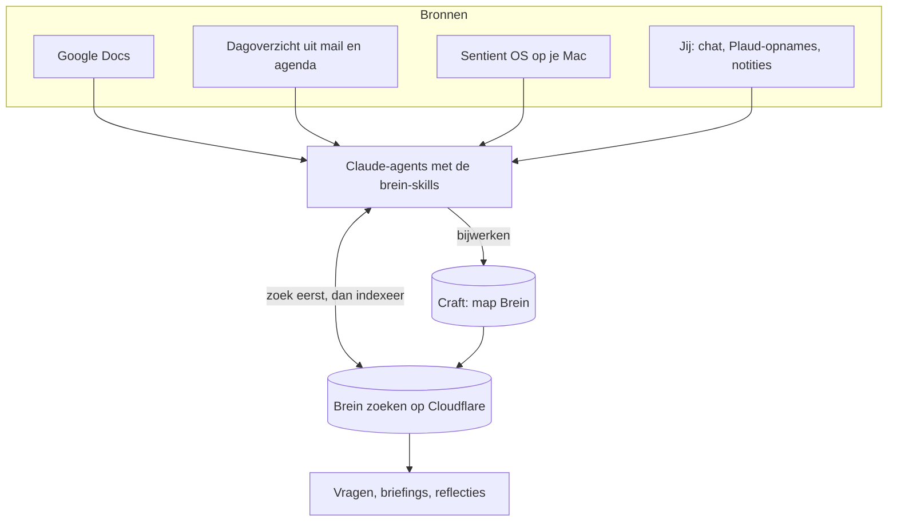

# Brein-kit

Een persoonlijk kennissysteem dat zichzelf bijhoudt: één pagina per persoon, organisatie, gesprek of idee in **Craft**, elke nacht bijgewerkt door **Claude** uit je documenten, mail en berichten, en doorzoekbaar via een eigen zoekdienst op **Cloudflare**.

Losjes gebaseerd op het GBrain-concept van Garry Tan, en uitgebreid met eigen inzichten uit de praktijk.

> Dit is een werkende opzet uit de praktijk, geen kant-en-klaar product. Je hebt wat technische handigheid nodig (een terminal, Node.js, een Cloudflare-account). Reken op een middag om alles in te richten.

## Wat erin zit

| Map | Inhoud |
| --- | --- |
| [`skills/`](skills) | Acht Claude-skills die de werkwijze vastleggen. Begin bij `brein-basis`. |
| [`zoekdienst/`](zoekdienst) | De Cloudflare-worker `brein-zoek`: hybride zoeken, relatiegraaf, MCP-connector voor Claude. |
| [`geplande-taken/`](geplande-taken) | De prompts van de zeven geplande taken die het Brein dagelijks en wekelijks bijhouden. |
| [`docs/schema.md`](docs/schema.md) | Schema's van de architectuur en het dagritme. |

## Hoe het werkt



1. **Bronnen.** Wat je al doet wordt de grondstof.
2. **Verwerking.** Claude volgt vaste skills: eerst zoeken, dan een bestaande pagina bijwerken, altijd met bron. Nieuwe pagina's alleen na jouw akkoord.
3. **Opslag.** Craft is de waarheid. De zoekindex is een afgeleide die na elke wijziging wordt bijgewerkt.
4. **Gebruik.** Vraag het in elke chat; Claude zoekt eerst in je Brein en antwoordt met links.

## Wat je nodig hebt

- **Claude** (Pro of hoger) met ondersteuning voor skills, connectoren en geplande taken.
- **Craft** met de Craft-connector in Claude.
- **Cloudflare**-account (gratis volstaat om te beginnen): Workers, Workers AI, Vectorize en D1.
- Optioneel: **Google Drive / Gmail / Google Agenda**-connectoren, **Plaud** voor gespreksopnames en **[Sentient OS](https://github.com/Sentient-OS-Labs/sentient-os)** op een Mac voor berichten en notities.

## Installeren

1. **Craft-mappen.** Maak in Craft een map `Brein` met de submappen `Mensen`, `Organisaties`, `Gesprekken`, `Ideeën & Concepten`, `Bronnen` (met daarin `Dagoverzichten`), `Reflecties` en `Werkwijze`, plus een document `Feiten` met een collectie. Noteer van elke map het ID (via de Craft-connector: `folders list`) en je space-ID.
2. **Skills invullen.** Vervang in `skills/*/SKILL.md` de plaatshouders (`<SPACE_ID>`, `<ID_MENSEN>`, `<ID_ORGANISATIES>`, …) door jouw ID's. Zie de tabel in `skills/brein-basis/SKILL.md`.
3. **Skills toevoegen.** Voeg de acht skills toe aan je Claude-account via de skills-instellingen van Claude. Zet een kopie in Craft (Brein/Werkwijze) als je ook andere agents dezelfde werkwijze wilt laten volgen.
4. **Zoekdienst uitrollen.** Volg [`zoekdienst/README.md`](zoekdienst/README.md). Kort: `cd zoekdienst && npm install && ./setup.sh`. Het script maakt de database en index aan, zet een geheime sleutel en toont de connector-URL.
5. **Connector toevoegen.** Voeg die URL in Claude toe als aangepaste connector met de naam `Brein zoeken`. **Behandel de URL als een wachtwoord.**
6. **Voorkeur instellen.** Laat Claude in je voorkeuren onthouden: *"Bij vragen over mensen, organisaties, projecten of eerdere gesprekken: eerst zoeken in mijn Brein en gebruiken wat daar staat, met links."*
7. **Geplande taken.** Maak de taken uit [`geplande-taken/`](geplande-taken) aan als geplande taken in Claude, met je eigen map-ID's en tijden. Begin met de zoekindex (1) en de wekelijkse controle (6); voeg de rest toe als je de bron hebt.
8. **Vullen.** Vraag Claude bijvoorbeeld: *"Maak een pagina voor <persoon>"* (brein-persoon), *"Verwerk dit gesprek"* (brein-gesprek) of *"Zet in mijn Brein dat …"* (brein-vastleggen).

## Paginasjabloon

```markdown
**In één zin:** wie of wat dit is, met links.

## Relaties
- klant van → [Naam](block://<id>) (toelichting)

## Stand van zaken
- Feit. [Bron: gesprek <onderwerp>, JJJJ-MM-DD]

## Open punten
- [ ] Wie doet wat, wanneer.

## Tijdlijn
- **JJJJ-MM-DD** | Gesprek: [titel](block://<id>) — één regel kern
```

De vijf spelregels die alles betrouwbaar houden:

1. **Eén pagina per onderwerp.** Zoek met naamvarianten voordat je iets aanmaakt.
2. **Elk feit met bron en datum.** Tegenstrijdigheden blijven zichtbaar, met beide bronnen.
3. **Links in twee richtingen.** Linkt A naar B, dan krijgt B ook een link naar A.
4. **Stand van zaken is de actuele waarheid; de Tijdlijn groeit alleen aan.**
5. **Na elke wijziging opnieuw indexeren.**

## Privacy en grenzen

- Alles staat in jouw eigen Craft-, Google- en Cloudflare-omgeving.
- De skills leggen nooit wachtwoorden, sleutels, rekening-, kaart- of identificatienummers vast, en geen gezondheidsinformatie over anderen tenzij je daar zelf om vraagt.
- Geplande taken maken geen nieuwe pagina's en verwijderen niets; voorstellen komen ter goedkeuring in de wekelijkse reflectie.
- Sentient OS leest berichten lokaal op je Mac; alleen samenvattingen gaan verder.

## Verantwoording

Licentie: MIT, zie [LICENSE](LICENSE).

Craft, Claude, Cloudflare, Google, Sentient OS en Plaud zijn merken van hun eigenaars. Dit project is daar niet aan verbonden.
