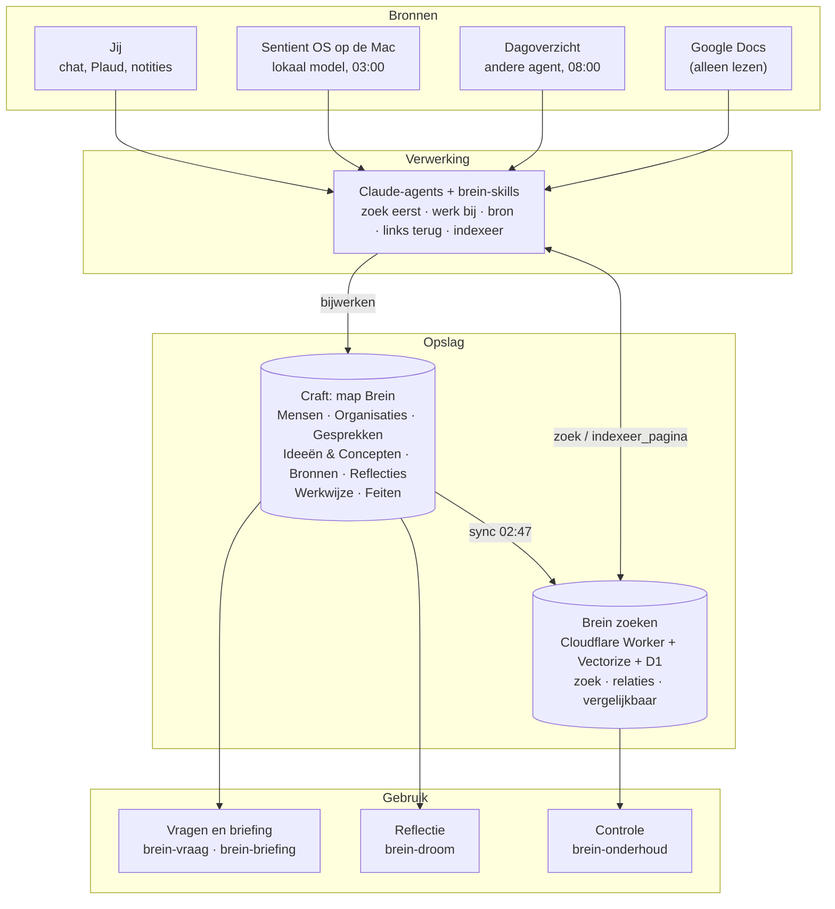
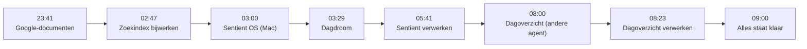

# Schema's

## Architectuur

## Dagritme

Wekelijks: **zondag 19:42** de weekdroom (reflectie plus een lijst *Ter goedkeuring* met voorgestelde nieuwe pagina's) en **maandag 07:13** de controle (links terug, dubbelingen, verouderde info, zoekindex).

| Taak | Tijd | Mag schrijven | Prompt |
| --- | --- | --- | --- |
| Google-documenten | dagelijks 23:41 | bestaande pagina's + verslag | [3](../geplande-taken/3-google-documenten.md) |
| Zoekindex bijwerken | dagelijks 02:47 | alleen de index | [1](../geplande-taken/1-zoekindex.md) |
| Dagdroom | dagelijks 03:29 | alleen Reflecties | [2](../geplande-taken/2-dagdroom.md) |
| Sentient OS verwerken | dagelijks 05:41 | bestaande pagina's + verslag | [4](../geplande-taken/4-sentient-os.md) |
| Dagoverzicht verwerken | dagelijks 08:23 | bestaande pagina's + sectie op het overzicht | [5](../geplande-taken/5-dagoverzicht.md) |
| Wekelijkse controle | maandag 07:13 | niets, alleen rapport | [6](../geplande-taken/6-wekelijkse-controle.md) |
| Weekdroom | zondag 19:42 | alleen Reflecties | [7](../geplande-taken/7-weekdroom.md) |

## Skills

| Skill | Wanneer | Schrijft? |
| --- | --- | --- |
| brein-basis | vóór elke lees- of schrijfactie | — |
| brein-vraag | "wat weet ik over…", "wie is…" | nee |
| brein-vastleggen | "zet in mijn Brein…" | bestaande pagina's |
| brein-persoon | pagina maken of verrijken | nieuw na akkoord |
| brein-gesprek | opname, transcript of samenvatting | gesprekspagina + deelnemers |
| brein-briefing | dagbriefing, mail verwerken | bestaande pagina's |
| brein-droom | reflectie, patronen, voorstellen | alleen Reflecties |
| brein-onderhoud | links, dubbelingen, verouderde info | rapport; repareren na akkoord |
